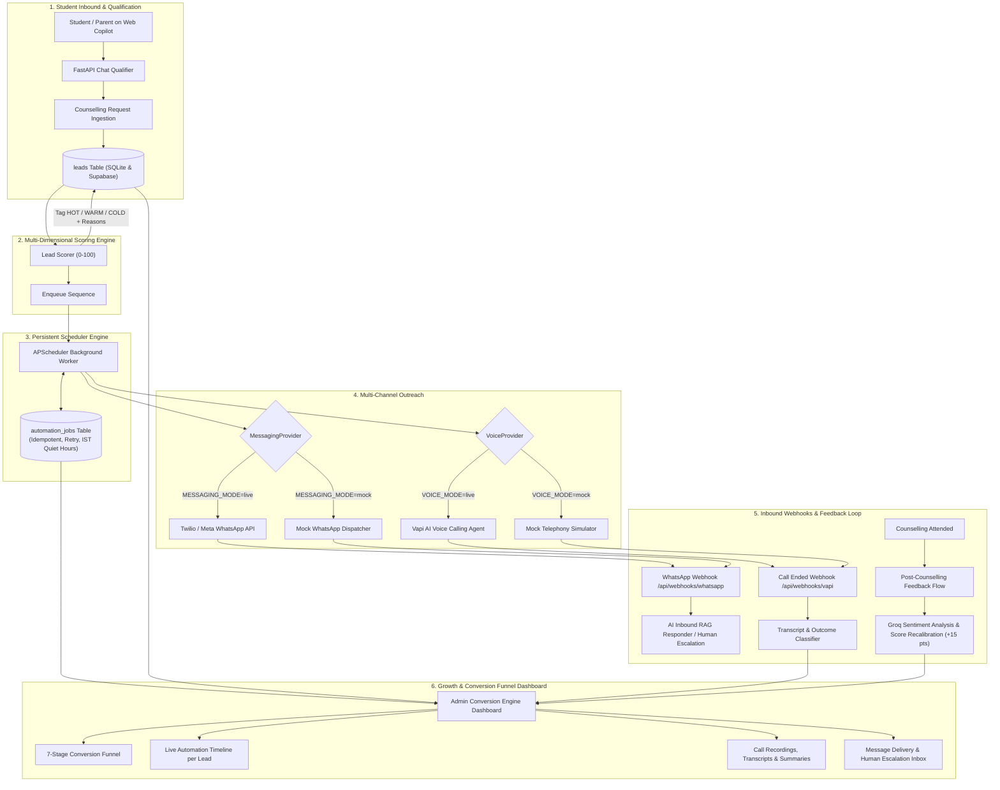

# 🚀 NIAT AI ADMISSION CONVERSION ENGINE (LAYER 2)

An autonomous, connected multi-component AI Admission Conversion Engine engineered for **NIAT** (NxtWave of Innovation in Advanced Technologies).

It turns the inbound admission copilot into an automated, end-to-end conversion system:
**Chat Qualifier $\rightarrow$ Multi-Dimensional Lead Scoring (0–100) $\rightarrow$ Persistent Scheduler (APScheduler) $\rightarrow$ Personalized WhatsApp Sequence $\rightarrow$ Grounded AI Voice Calling Agent $\rightarrow$ Post-Counselling Feedback Bot $\rightarrow$ Aggregated 7-Stage Funnel Dashboard.**

---

## 🌟 Architecture & Component Breakdown



---

## ⚙️ Quickstart & Setup

### 1. Prerequisites
- Python 3.10+
- Node.js 18+ and npm
- (Optional) Free Groq API Key, Supabase Project, Twilio Account, or Vapi Account

### 2. Backend Installation
```bash
# In the project root
python -m pip install -r backend/requirements.txt
```

### 3. Frontend Installation
```bash
cd frontend
npm install
cd ..
```

### 4. Running the Complete System
Open two terminals in the root directory:

**Terminal 1: Start Backend (FastAPI + Scheduler on port 8000)**:
```bash
# PowerShell
$env:PYTHONPATH="."
python -m uvicorn backend.main:app --host 127.0.0.1 --port 8000 --reload
```

**Terminal 2: Start Frontend (React + Vite on port 5173)**:
```bash
cd frontend
npm run dev
```

Visit [http://localhost:5173](http://localhost:5173) in your browser.

---

## 🔑 Environment Variables Reference (`.env`)

Create a `.env` file in the project root (copied from `.env.example`):

| Variable | Default / Mode | Description |
| :--- | :--- | :--- |
| `GROQ_API_KEY` | `gsk_...` | Groq API Key for LLM dynamic generation & feedback sentiment analysis. |
| `GROQ_MODEL` | `openai/gpt-oss-120b` | Model used for chat reasoning and WhatsApp copy generation. |
| `DATABASE_URL` | `sqlite+aiosqlite:///niat_copilot.db` | Local asynchronous SQLite database path. |
| `SUPABASE_URL` | `https://your-ref.supabase.co` | Supabase Postgres Cloud URL. |
| `SUPABASE_KEY` | `sb_publishable_...` | Supabase Anon / Service API key. |
| `MESSAGING_MODE` | `mock` or `live` | Toggle between local simulated WhatsApp and live external API. |
| `WHATSAPP_PROVIDER` | `twilio` or `meta` | Selected live WhatsApp provider implementation. |
| `TWILIO_ACCOUNT_SID` | `AC...` | Twilio Account SID (for live WhatsApp messaging). |
| `TWILIO_AUTH_TOKEN` | `...` | Twilio Auth Token. |
| `TWILIO_WHATSAPP_NUMBER`| `+14155238886` | Twilio WhatsApp sender phone number. |
| `META_WHATSAPP_TOKEN` | `EAAG...` | Meta Graph API user token (for Meta Cloud API). |
| `META_PHONE_NUMBER_ID` | `...` | Meta WhatsApp Phone Number ID. |
| `META_VERIFY_TOKEN` | `niat_copilot_webhook_verify_secret_token` | Webhook verification secret token for Meta challenge. |
| `VOICE_MODE` | `mock` or `live` | Toggle between local simulated calling agent and live Vapi. |
| `VOICE_PROVIDER` | `vapi` or `mock` | Selected voice provider implementation. |
| `VAPI_API_KEY` | `vapi-api-key-...` | Vapi API key for outbound AI phone calls. |
| `VAPI_PHONE_NUMBER_ID` | `...` | Vapi registered telephony phone number ID. |
| `VAPI_ASSISTANT_ID` | `...` | Vapi assistant ID for outbound prompts. |

---

## 📡 Webhook URLs & Payloads

### 1. Inbound WhatsApp Webhook
- **URL**: `POST http://127.0.0.1:8000/api/webhooks/whatsapp`
- **Meta Verification (GET)**: `GET /api/webhooks/whatsapp?hub.mode=subscribe&hub.challenge=1234&hub.verify_token=niat_copilot_webhook_verify_secret_token`
- **Inbound Payload (JSON)**:
```json
{
  "from": "+919876543210",
  "body": "Can you explain the scholarship requirements?",
  "channel": "mock"
}
```
- **Special Keywords Handled**:
  - `STOP` / `UNSUBSCRIBE`: Immediately cancels all scheduled automation jobs and marks candidate `opted_out = 1`.
  - `1`, `2`, `3`, `4`, `5`: Ingested as post-counselling rating response, triggering Groq sentiment analysis and lead score recalibration.
  - Queries mentioning `"human"`, `"counsellor"`, `"talk to someone"`: Automatically flagged with `escalated_to_human = 1` and low confidence score ($0.50$).

### 2. Vapi End-of-Call Telephony Webhook
- **URL**: `POST http://127.0.0.1:8000/api/webhooks/vapi`
- **Sample Payload**:
```json
{
  "message": {
    "call": { "id": "call_99x" },
    "durationSeconds": 124,
    "transcript": "Student confirmed interest in Hyderabad AI/ML and requested a slot tomorrow.",
    "summary": "Agreed to reschedule counselling for tomorrow 5 PM.",
    "analysis": { "outcome": "reschedule" }
  }
}
```

---

## 🧪 Accelerated Pipeline Simulation & Demo

Run the end-to-end accelerated simulation script:
```bash
# PowerShell
$env:PYTHONPATH="."
python scripts/simulate_lead.py
```

This runs a candidate through all 6 stages in under 15 seconds:
1. Registers candidate **Aarav Sharma** (Class 12 PCM 2026, Chaitanya Hyderabad).
2. Computes multi-dimensional score: **82 / 100 [HOT]** with explainable reasons.
3. Generates and dispatches personalized Day 0 WhatsApp message.
4. Simulates non-response detection $\rightarrow$ triggers grounded AI voice agent call (`RESCHEDULE`).
5. Books counselling session $\rightarrow$ schedules idempotent 24h & 1h reminders.
6. Simulates session attendance $\rightarrow$ dispatches feedback bot survey.
7. Ingests 5-star WhatsApp rating $\rightarrow$ Groq sentiment analysis (`POSITIVE`) $\rightarrow$ recalibrates score to **97 / 100 [HOT]**.
8. Prints complete 7-stage conversion funnel analytics.

---

## 📋 Running Automated Tests

Run the full pytest suite:
```bash
# PowerShell
$env:PYTHONPATH="."
python -m pytest backend/tests/test_scoring.py backend/tests/test_scheduler_idempotency.py backend/tests/test_whatsapp_webhooks.py
```
**Test Results**: `9 passed in 29.93s`
- `test_scoring.py`: HOT ($\ge 70$), WARM (40–69), and COLD ($< 40$) boundary conditions.
- `test_scheduler_idempotency.py`: Unique job constraints, IST quiet hours (09:00–21:00), and cancellation cascades.
- `test_whatsapp_webhooks.py`: Meta token verification, `STOP` opt-out compliance, and human escalation flags.

---

## ⚠️ Known Limitations & Production Considerations

1. **Twilio WhatsApp Sandbox Requirement**:
   - In live mode (`MESSAGING_MODE=live`), Twilio trial accounts require recipient numbers to first send `join <your-sandbox-keyword>` to the Twilio number before messages can be delivered.
   - For demo purposes without recipient pre-opt-in, keep `MESSAGING_MODE=mock` (which writes to the same `whatsapp_messages` table and simulates real delivery).
2. **Inbound Webhook Public Reachability**:
   - For live incoming webhooks from Meta or Vapi in local development, use an HTTP tunnel like `ngrok http 8000` to expose `http://127.0.0.1:8000` to the internet.
3. **IST Quiet Hours (09:00 - 21:00)**:
   - The scheduler automatically enforces Indian legal tele-calling quiet hours. Any messages or calls scheduled between 21:00 and 09:00 IST are postponed to 09:00 AM the following morning.
4. **Vapi Outbound Telephony Costs**:
   - Vapi live calling requires account credits and a provisioned Twilio/Vonage SIP trunk. When `VOICE_MODE=mock`, the system generates realistic transcripts, summaries, and outcomes with zero carrier fees.
